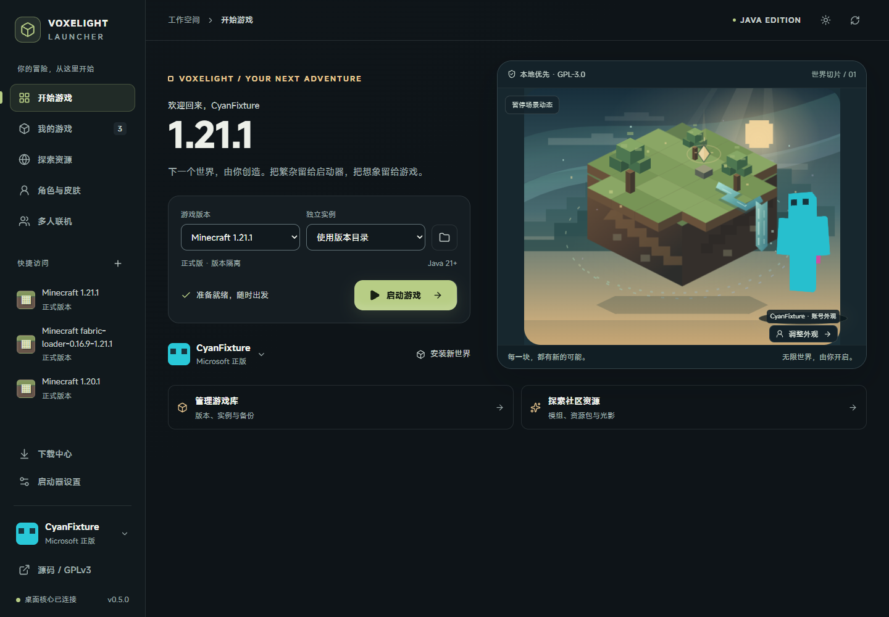

# Voxelight Launcher

Voxelight Launcher is a Minecraft Java desktop launcher built with Rust, Tauri 2, React and TypeScript. Its original interface includes the animated WorldScene hero and a skinview3d WebGL character preview. The application entry points are `src/main.tsx` and `src-tauri/src/main.rs`.

This directory contains only the active Rust application. WinUI is not part of this project.



## Open-source license and source

Original project code and original artwork are **GPL-3.0-only**. See `LICENSE`, `NOTICE` and `THIRD_PARTY_NOTICES.md`. Third-party dependencies keep their own licenses; their notices are collected in `licenses/`.

Source repository: https://github.com/L1angYun/Voxelight-Launcher

The source archive contains the Rust/React sources, original assets, build scripts, tests and lockfiles. It does not contain user accounts, tokens, save games, downloaded game clients, build outputs or proprietary UI sources. `python scripts/package-source.py --output <output.zip>` creates and verifies a source archive matching the current files.

New configurations default to Steve, with Alex also available. The home preview prioritizes the selected account's actual skin, model and cape rather than replacing them with a default character. Steve and Alex textures are read at runtime from a hash-verified official Minecraft client, rather than being bundled as project assets. If the selected client texture is unavailable, the launcher shows an empty preview with retry or local-import actions instead of substituting another character. Voxelight Launcher is unofficial and is not endorsed by Mojang or Microsoft.

## Data isolation

The default launcher data directory is `%LOCALAPPDATA%\dev.voxelight.launcher`, matching the application identifier and deliberately separate from the NSIS program directory `%LOCALAPPDATA%\Voxelight Launcher`. Existing accounts, service secrets, settings and instances from other launchers are not imported automatically.

Portable runs and isolated tests can override these locations explicitly:

- `VOXELIGHT_LAUNCHER_DATA_DIR`: launcher state, encrypted service secrets and managed runtimes.
- `VOXELIGHT_LAUNCHER_GAME_DIR`: Minecraft versions, libraries, assets and instances.

The former `MINECRAFT_LAUNCHER_*` variables remain explicit override aliases. They do not enable legacy data migration.

## Download sources and game safety

Settings offers three download modes: `official` uses only Mojang/Minecraft sources, `auto` tries the official source before BMCLAPI, and `bmclapi` tries BMCLAPI before the official fallback. The mirror applies to supported vanilla metadata, clients, libraries, assets, logging, hash-verified Java runtime entries and the official server JAR. It does not invent mirrors for Quilt, Modrinth, CurseForge, OptiFine or arbitrary Maven hosts.

Version-manifest v2 entries retain the official URL and expected SHA-1. Files are checked before being committed. A hash supplied by a mirrored manifest belongs to that mirror's trust chain and is not independent Mojang signing. BMCLAPI is a community service, not an official Mojang endpoint.

A running instance cannot be launched twice or modified by backup, clone, restore, export or removal operations. Separate instances can run the same game version independently, and an instance can be restarted after its process exits.

The Rust HTTP client honors the existing Windows system proxy through reqwest's `system-proxy` support. Proxy use does not disable TLS verification, redirect restrictions or content hashes. Local test fixtures explicitly bypass proxies so they cannot accidentally reach external services.

## Run

Requirements: Node.js 22+, Rust stable with the MSVC target, Visual Studio C++ build tools, Windows SDK and WebView2 on Windows. Python 3 is used for original asset generation and source packaging; only `scripts/generate-installer-assets.py` additionally needs Pillow. The license collector uses the system `tar` in local-archive mode and does not run dependency install scripts.

```powershell
npm ci
npm run desktop:dev
```

Build the Windows desktop application and NSIS installer with `powershell -File scripts/build.ps1` (wraps the Tauri build and configures the Rust PATH). The 0.6.0 installer and matching GPL source archive are collected under `releases/0.6.0/`; earlier releases remain unchanged. See the [0.6.0 implementation and verification report](docs/reports/frontend-completion-0.6.0.md) for measured results and manual checks still outstanding. The NSIS installer uses the standard current-user installation mode and includes the GPL and third-party notices under `licenses/`. It does not require administrator rights.

`scripts/desktop.ps1` is an optional helper when local PowerShell policy permits unsigned local scripts. Do not change that policy merely to build the app: the npm commands above invoke the same Tauri toolchain.

If the project or build directory has a Windows **Low mandatory label**, its native executables inherit that label and Java may be unable to write ordinary game data. The same label can prevent a setup from replacing files in a normal installation directory; copy the setup to a normal per-user directory before running it. This is a Windows file-integrity issue, not an Authenticode requirement. Do not weaken ACLs, integrity labels or system security settings. For development, select a normal per-user build output before starting Tauri:

```powershell
$env:CARGO_TARGET_DIR = "$env:LOCALAPPDATA\Temp\VoxelightLauncher\build"
npm run desktop:dev
```

The optional helper performs this check for `dev` without changing ACLs or labels. The normal NSIS installation directory is independent of the source directory's inherited label.

`npm run dev` starts a browser preview. It can display the interface, WebGL skins and public resource search, but cannot access local game files or launch games.

## Verification

```powershell
npm run build
npm test
npm run test:e2e
cargo test --manifest-path src-tauri/Cargo.toml --locked
npm run license:check
```

The license check reads the locked npm/Cargo dependency graph and compares it with the collected notices. After intentionally changing dependencies, run `npm run license:update` to refresh the inventory. Missing npm notices use the integrity-checked registry metadata/package and verified upstream source; missing Cargo notices use the source commit recorded by Cargo. Packages without a standalone license file retain their actual metadata and the official SPDX text, with that distinction recorded in `licenses/dependency-inventory.json`; no copyright lines are invented.

`npm run source:package` creates and verifies the GPL source archive under `releases/<version>/`. It excludes dependencies, build outputs, user data, secrets, proprietary textures and restricted UI sources.

`node scripts/smoke-install.mjs` verifies an isolated current-user NSIS installation and uninstall, including registration, license resources, executable integrity and preservation of the real launcher data directory. It uses owned test directories and never reads account contents. If the source workspace has a Low mandatory label, copy the generated setup to a normal per-user directory and set `SMOKE_INSTALLER` to that copy; the script rejects a Low-labeled setup instead of silently testing an old installation. It also checks the installed file version. Set `SMOKE_REPORT` to choose its JSON report path.

`node scripts/smoke-native.mjs` runs isolated native IPC checks against a built Debug application. On Windows it rejects an executable with a Low mandatory label; set `SMOKE_BINARY` to the normally installed Release executable or another verified normal-location binary. Set `SMOKE_CACHE` to reuse immutable versions, libraries and assets from an isolated prior run; worlds and credentials are never copied. `SMOKE_CHECKS` optionally selects comma-separated substrings of check names for focused debugging; omit it for the full suite.

Test state is created below `src-tauri/target/native-*`; do not point the test overrides at personal launcher or game directories.

## Features and research

Start with [the documentation index](docs/README.md) for the current design, verification reports and directory layout.

See `docs/migration-status.md` for verified functionality and remaining limitations, and `docs/launcher-feature-catalog.md` for the competing-launcher feature inventory. Third-party component attribution is in `THIRD_PARTY_NOTICES.md`.

Microsoft device authorization requires your own OAuth Client ID. CurseForge requires your own API Key and is subject to each project's distribution permissions. Neither is configured by default; missing credentials are not treated as a successful login or restricted-download test.
