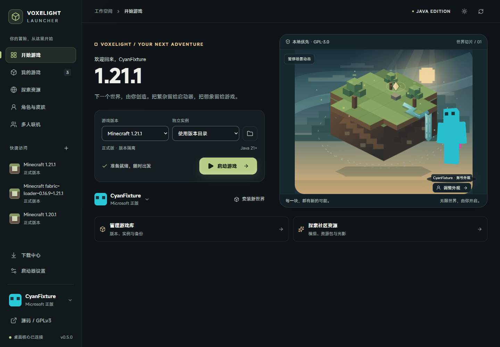

# Voxelight Launcher

English | [简体中文](README.zh-CN.md)

An open-source launcher for Minecraft: Java Edition on 64-bit Windows, built with Rust, Tauri 2, and React. Licensed under GPL-3.0-only. Unofficial: not affiliated with or endorsed by Mojang or Microsoft.



_Screenshot from 0.5.0; the interface has evolved since._

## Download

Download `VoxelightLauncher-<version>-x64-setup.exe` from [GitHub Releases](https://github.com/L1angYun/Voxelight_Launcher/releases) or the [Gitee mirror](https://gitee.com/liangyun_Liu/Voxelight_Launcher/releases) (identical binaries and `SHA256SUMS.txt`).

- Installs per-user with no administrator privileges (default: `%LOCALAPPDATA%\Voxelight Launcher`), and installs WebView2 if missing.
- **Official releases bundle a Microsoft Client ID and CurseForge API key**, so Microsoft sign-in and CurseForge work out of the box. Source builds include neither; see [Accounts and service keys](#accounts-and-service-keys).
- Stable updates can be verified (size + SHA-256) and installed in-app from **Settings → About**, with downgrade protection. Pre-release builds (`-alpha.N`, `-beta.N`, `-rc.N`) are published explicitly as pre-releases and automatically upgrade to the corresponding stable release once published.

## Highlights

- **Versions & Loaders** — Every release, snapshot, Beta/Alpha, and April Fools version; Fabric, Quilt, Forge, NeoForge, and OptiFine (local installer JAR or mirror); switch loaders on an existing instance without losing worlds or mods.
- **Instances & Content** — Isolated folders with per-instance Java, automatic or manual memory, JVM arguments, window size, and game proxy; backup/restore, clone, personal archive or Modrinth `.mrpack` export; world import/backup, per-world data packs, screenshots, live searchable game logs, and crash diagnostics.
- **Mod & Modpack Ecosystem** — Search and install mods, resource packs, shaders, and modpacks from Modrinth (with required dependencies and transactional rollback) and CurseForge; import `.mrpack`, CurseForge, MultiMC / Prism, and MCBBS packs; online modpack updates with diff plans and automatic backups; drag-and-drop import for mods, packs, and skins; batch enable/disable/delete for local resources.
- **Downloads & Proxy** — Unified resumable, hash-verified download queue with pause, resume, cancel, retry-all, and unfinished cleanup; Official, Automatic latency-measured, or BMCLAPI source; system proxy by default with automatic detection of Windows system proxies, environment variables, and common local HTTP proxy ports.
- **Accounts & Multiplayer** — Microsoft device-code login (with 3D skin preview, upload, and cape selection), offline accounts, and Authlib-injector; server list with status ping, LAN discovery, direct join, IPv4/IPv6 & NAT network diagnostics, and local managed servers (vanilla download or imported Paper/Spigot/Fabric/Forge/NeoForge JARs and `win_args.txt` folders) with console.
- **Interface & Localization** — Available in **7 languages** (Simplified Chinese, Traditional Chinese, English, Japanese, Korean, Russian, Spanish), following Windows theme, language, accent color, and accessibility preferences by default; Dark/Light themes, Full/Lite effects (unloads 3D world in Lite mode), interactive first-run welcome setup (OOBE), custom home background, keyboard shortcuts, settings search, and one-click factory reset (never deletes Minecraft files).
- **Lumen & Local MCP (Opt-in)** — Optional built-in assistant (**Lumen**) using your own OpenAI-compatible or Anthropic API key (or local loopback Ollama/LM Studio) with tiered permissions, proactive crash diagnosis, and an opt-in `127.0.0.1` MCP server. Completely invisible everywhere outside **Settings → Lumen & MCP** until configured.

## Accounts and service keys

- **Microsoft sign-in** uses the OAuth device-code flow; the launcher never sees your password.
- **CurseForge** requires an API key for search, downloads, and update checks; **Modrinth** requires no key.
- Releases bundle both. In a source build, or to use your own credentials, configure them in **Settings → General → Service connections**.
- **Offline accounts** work for single-player and offline-mode servers. **Authlib** passwords are sent only to the server you enter and are never saved.

## Your data

| Data | Location |
| --- | --- |
| Launcher data (settings, accounts, logs, Java runtimes, backups, servers, caches) | `%LOCALAPPDATA%\dev.voxelight.launcher` |
| Game directory (versions, libraries, assets, `instances\`) | `%APPDATA%\.minecraft` by default (**Settings → Game**) |

- Tokens, the CurseForge key, proxy credentials, and the Lumen API key are encrypted per Windows user via **Windows DPAPI** and excluded from exported presets.
- Uninstalling keeps launcher data unless you opt in to delete it; factory reset (**Settings → General → Restore initial state**) and uninstalling **never delete your Minecraft game directory, worlds, mods, backups, or server files**.
- `VOXELIGHT_LAUNCHER_DATA_DIR` and `VOXELIGHT_LAUNCHER_GAME_DIR` override these paths for secondary profiles or testing.

## Network

No telemetry, analytics, or crash reporting. Network requests go only to:

| Purpose | Hosts |
| --- | --- |
| Game files, version list, Java | Mojang; BMCLAPI when enabled in download source |
| Loaders | Fabric, Quilt, Forge, NeoForge; OptiFine via local JAR or BMCLAPI if enabled |
| Microsoft / Authlib accounts | Microsoft, Xbox Live, Minecraft services; your Authlib server & `authlib-injector.yushi.moe` |
| Content & modpacks | Modrinth, CurseForge; modpack external links (e.g. GitHub/GitLab) |
| Launcher updates | GitHub, Gitee |
| Multiplayer | Configured game servers; UDP 4445 (LAN); public STUN servers only when running a network check |
| Lumen & MCP | Only your configured AI endpoint when enabled and invoked; local MCP binds strictly to `127.0.0.1` and starts off |

## Download sources and proxy

- **Download source** (**Settings → Downloads**): **Official only** (default), **Automatic** (official first unless unavailable or clearly slower this session), or **BMCLAPI first**. Mirrored files are still verified against official hashes.
- **Network proxy**: Follow system (default), Off, or Custom `http://` / `https://`, with automatic detection of Windows system proxies, environment variables, and common local HTTP proxy ports. **Game proxy mode** defaults to Follow system and can be overridden per instance.

## Known limitations

- Windows x64 and Minecraft: Java Edition only.
- Shader packs require a shader loader mod such as Iris.
- Built-in server download provides vanilla servers; modded/plugin servers can be imported as a JAR or folder (including `win_args.txt` Forge/NeoForge servers). CurseForge resource installs do not auto-resolve dependencies.
- The Windows NSIS installer currently uses a fixed dark visual style rather than adapting dynamically to the Windows light/dark theme.
- Closing the window exits the launcher; interrupted downloads can be resumed or retried from **Downloads**.

## Building from source

Requires Windows x64, Node.js 22.13.0+ (22.x) or 24.0.0+, Rust 1.90+ (MSVC), Visual Studio C++ build tools + Windows SDK, WebView2, and Git.

```powershell
npm ci
npm run desktop:dev      # run in development
npm run desktop:build    # build the installer
```

Versioning conventions, testing, source packaging, and release steps: [docs/development.md](docs/development.md) · [CHANGELOG.md](CHANGELOG.md).

## License

[GPL-3.0-only](LICENSE); see [NOTICE](NOTICE) and [THIRD_PARTY_NOTICES.md](THIRD_PARTY_NOTICES.md). Third-party licenses live in [licenses/](licenses/). The MiSans typeface is provided under Xiaomi's license. Default Steve/Alex textures are read from a verified official Minecraft client rather than bundled.

Minecraft is a trademark of Mojang and Microsoft.

Source: [GitHub](https://github.com/L1angYun/Voxelight_Launcher) · [Gitee](https://gitee.com/liangyun_Liu/Voxelight_Launcher)
