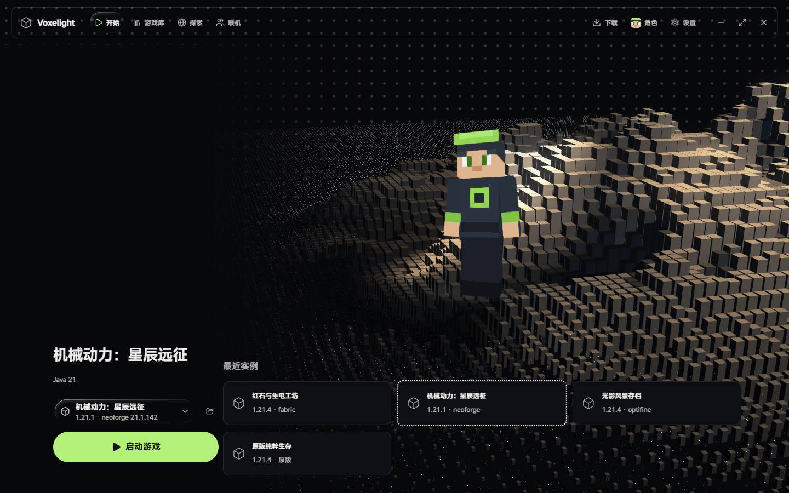
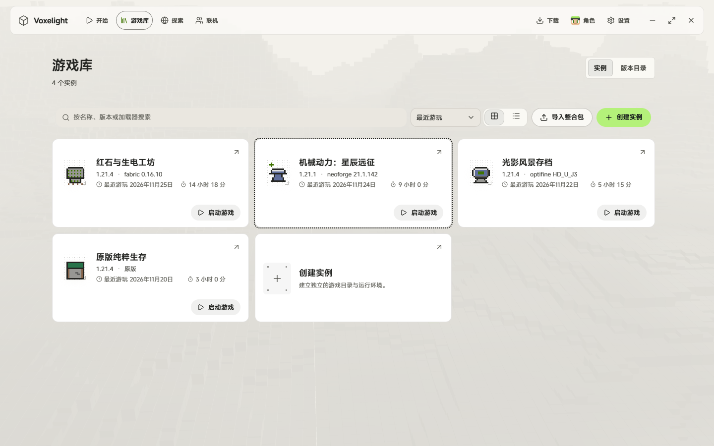

# Voxelight Launcher

[English](README.md) | 简体中文

开源的 Minecraft: Java 版启动器，面向 64 位 Windows，使用 Rust、Tauri 2 和 React 构建，采用 GPL-3.0-only 许可。非官方项目，与 Mojang 及 Microsoft 无关，也未获其认可。



<details>
<summary>浅色主题与实例库预览</summary>



</details>

## 下载

前往 [GitHub Releases](https://github.com/L1angYun/Voxelight_Launcher/releases) 或 [Gitee 镜像](https://gitee.com/liangyun_Liu/Voxelight_Launcher/releases) 下载 `VoxelightLauncher-<版本>-x64-setup.exe`（两端产物与 `SHA256SUMS.txt` 完全一致）。

- 仅安装到当前用户目录，无需管理员权限（默认 `%LOCALAPPDATA%\Voxelight Launcher`），缺少 WebView2 时自动补装。
- **官方发布版已内置 Microsoft Client ID 与 CurseForge API Key**，微软登录与 CurseForge 开箱即用；从源码自行构建的版本不含内置凭据，见[账号与服务凭据](#账号与服务凭据)。
- 支持在 **设置 → 关于** 中核对文件大小与 SHA-256 后自动升级，且拒绝降级覆盖。可在 **更新通道** 中选择 **稳定版**（默认，仅正式发布）或 **测试版（Beta）**（额外接收 `-alpha.N` / `-beta.N` / `-rc.N` 预发布版本）；预发布版本待对应正式版发布后也会自动升级到正式版。

## 核心特性

- **版本与加载器** — 覆盖全部正式版、快照、远古版（Beta/Alpha）与愚人节版；支持 Fabric、Quilt、Forge、NeoForge 与 OptiFine（导入官方安装器 JAR），并可为已有实例更换加载器（更换前自动备份）。
- **实例与内容管理** — 独立实例目录，可按实例覆盖 Java、自动/手动内存、JVM 参数、窗口尺寸与游戏代理；支持实例备份恢复、克隆、个人备份或 Modrinth `.mrpack` 导出；支持世界导入备份、按世界管理数据包、截图浏览、可搜索筛选的实时游戏日志与崩溃诊断报告。
- **模组与整合包生态** — 对接 Modrinth（自动拉取必需依赖、事务更新与回退）与 CurseForge，支持模组、资源包、光影与整合包搜索安装；支持导入 `.mrpack`、CurseForge、MultiMC / Prism 及 MCBBS 整合包；支持在线整合包差异计划更新与自动备份；支持拖放导入模组、整合包与皮肤，以及本地资源批量启停与删除。
- **下载中心与本机代理** — 统一任务队列，支持断点续传、多连接、哈希校验、暂停/恢复/取消、全部重试与清理未完成项；支持仅官方源、自动测速优选与 BMCLAPI 优先；代理默认跟随系统，并支持自动检测 Windows 系统代理、环境变量与常见本机 HTTP 代理端口一键采用。
- **账号与联机服务端** — 支持微软正版设备码登录（含 3D 皮肤预览、上传与披风选择）、离线账号及 Authlib 第三方认证；支持服务器列表测速、局域网发现、直连、IPv4/IPv6 与 NAT 网络检测，以及本地托管服务端（原版自动下载或导入 Paper/Spigot/Fabric/Forge/NeoForge JAR 及 `win_args.txt` 参数启动目录）和控制台管理。
- **界面与多语言** — 内置 **7 门语言**（简体中文、繁體中文、English、日本語、한국어、Русский、Español），默认跟随 Windows 主题、语言、强调色与辅助功能设置；提供深浅主题、完全/精简特效（精简模式卸载 3D 世界以节省内存）、交互式首次使用引导（OOBE）、自定义首页背景、全局快捷键、设置搜索与一键还原初始状态（绝不删除 Minecraft 游戏文件）。
- **Lumen 与本地 MCP（可选）** — 可选内置助手 **Lumen**，使用你自己的 OpenAI 兼容或 Anthropic API Key（或本机回环 Ollama / LM Studio），支持分级权限确认、崩溃主动唤醒诊断以及仅限 `127.0.0.1` 的本地 MCP 服务。未配置前在 **设置 → Lumen 与 MCP** 之外完全不可见。

## 账号与服务凭据

- **微软登录**采用 OAuth 设备码流程，启动器不会接触你的密码。
- **CurseForge** 的搜索、下载和更新检查需要 API Key；**Modrinth** 无需密钥。
- 官方发布版已内置上述凭据；源码构建或想换用自己的凭据时，可在 **设置 → 通用 → 服务接入** 中填写。
- **离线账号**适用于单人游戏与离线服务器；**Authlib** 密码仅发往你指定的认证服务器，不会保存。

## 数据位置

| 数据 | 路径 |
| --- | --- |
| 启动器数据（设置、账号、日志、Java 运行时、备份、服务端、缓存） | `%LOCALAPPDATA%\dev.voxelight.launcher` |
| 游戏目录（版本、库文件、资源文件、`instances\`） | 默认 `%APPDATA%\.minecraft`（可在 **设置 → 游戏** 修改） |

- 登录令牌、CurseForge Key、代理凭据与 Lumen API Key 均通过 **Windows DPAPI** 按当前 Windows 用户加密存储，导出配置预设时不会包含。
- 卸载时默认保留应用数据；无论是卸载还是 **设置 → 通用 → 还原为初始状态**，均**绝不会删除你的 Minecraft 游戏目录、世界存档、模组、备份或托管服务端文件**。
- 可通过 `VOXELIGHT_LAUNCHER_DATA_DIR` 与 `VOXELIGHT_LAUNCHER_GAME_DIR` 指定独立数据或游戏目录用于多配置或测试。

## 网络连接

不含遥测、统计或崩溃上报。启动器仅在需要时连接以下服务：

| 用途 | 目标地址 |
| --- | --- |
| 游戏文件、版本清单、Java | Mojang；下载源允许时也使用 BMCLAPI |
| 加载器 | Fabric、Quilt、Forge、NeoForge 官方服务；OptiFine 需导入自行下载的官方安装器 JAR |
| 微软 / 第三方账号 | Microsoft、Xbox Live、Minecraft 服务；你填写的 Authlib 服务器与 `authlib-injector.yushi.moe` |
| 资源与整合包 | Modrinth、CurseForge；整合包清单声明的外部文件来源（如 GitHub / GitLab） |
| 启动器更新 | GitHub、Gitee |
| 联机 | 你添加的游戏服务器；UDP 4445（局域网发现）；仅在主动点击网络检测时访问公开 STUN 服务器 |
| Lumen 与 MCP | 仅在配置并触发对话或崩溃诊断时连接你填写的 AI 接口；本地 MCP 默认关闭且仅监听 `127.0.0.1` |

## 下载源与代理

- **游戏下载源**（**设置 → 下载**）：**仅官方源**（默认）、**自动**（官方优先，本次运行中明显更慢或无响应时切换 BMCLAPI）、**BMCLAPI 优先**。经镜像下载的文件同样执行官方哈希校验。
- **网络代理**：默认跟随系统，也可关闭或自定义 `http://` / `https://`，支持自动检测 Windows 系统代理、环境变量与常见本机 HTTP 代理端口。**游戏代理模式**同样默认跟随系统，并支持按实例单独覆盖。

## 已知限制

- 仅支持 64 位 Windows 与 Minecraft: Java 版。
- 光影包需搭配 Iris 等光影加载器模组使用。
- 内置服务端下载仅提供原版，其他服务端（包括基于 `win_args.txt` 启动的 Forge / NeoForge 服务端）需以 JAR 或目录导入；CurseForge 单项资源安装不自动解析依赖。
- Windows NSIS 安装程序当前采用固定浅色外观，暂未动态跟随系统浅/深色主题。
- 关闭窗口即退出启动器；未完成的下载可在 **下载** 页继续或重试。

## 从源码构建

需要 64 位 Windows、Node.js 22.13.0+（22.x）或 24.0.0+、Rust 1.90+（MSVC）、带 Windows SDK 的 Visual Studio C++ 生成工具、WebView2 与 Git。

```powershell
npm ci
npm run desktop:dev      # 开发运行
npm run desktop:build    # 构建安装包
```

版本号规范、测试方法、源码包与发布流程详见 [docs/development.zh-CN.md](docs/development.zh-CN.md) 与 [CHANGELOG.md](CHANGELOG.md)。

## 许可

采用 [GPL-3.0-only](LICENSE) 许可，另见 [NOTICE](NOTICE) 与 [THIRD_PARTY_NOTICES.md](THIRD_PARTY_NOTICES.md)；第三方许可清单位于 [licenses/](licenses/)。MiSans 字体遵循小米字库许可协议；仓库不包含 Steve/Alex 贴图，启动器直接从经哈希校验的官方客户端读取。

Minecraft 是 Mojang 和 Microsoft 的商标。

源码：[GitHub](https://github.com/L1angYun/Voxelight_Launcher) · [Gitee](https://gitee.com/liangyun_Liu/Voxelight_Launcher)
