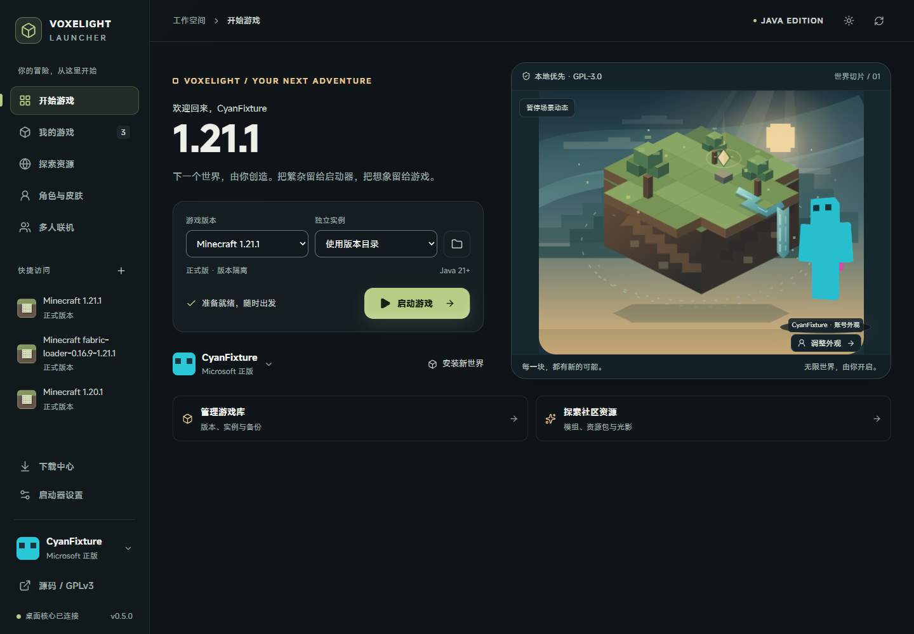

# Voxelight Launcher

[English](README.md) | 简体中文

开源的 Minecraft: Java 版启动器，运行于 64 位 Windows，使用 Rust、Tauri 2 和 React 开发，采用 GPL-3.0-only 许可。非官方项目，与 Mojang 和 Microsoft 无关，也未获其认可。



_截图来自 0.5.0，当前界面已有变化。_

## 下载

从 [GitHub Releases](https://github.com/L1angYun/Voxelight_Launcher/releases) 或 [Gitee 镜像](https://gitee.com/liangyun_Liu/Voxelight_Launcher/releases) 下载 `VoxelightLauncher-<版本>-x64-setup.exe`，两处文件相同。

- 只为当前用户安装，不需要管理员权限，默认安装到 `%LOCALAPPDATA%\Voxelight Launcher`。缺少 WebView2 运行时会自动安装。
- **发布版内置了 Microsoft Client ID 和 CurseForge API Key**，Microsoft 登录和 CurseForge 无需任何设置即可使用。从源码构建的版本没有这两项，见[账号与服务凭据](#账号与服务凭据)。
- 在 **设置 → 关于 → 下载并更新** 中更新，启动器会先核对安装程序的大小和 SHA-256。不会用旧版本覆盖新版本。

## 功能

✅ 已提供 · 🚧 计划中。计划项完成后会更新这张表。

| 类别 | 功能 | 状态 |
| --- | --- | --- |
| 版本 | 所有正式版和快照，可搭配 Fabric、Quilt、Forge 或 NeoForge | ✅ |
| 版本 | 版本列表分为正式版、快照、远古版（Beta/Alpha）和愚人节版，可搜索、排序，显示发布日期 | ✅ |
| 版本 | OptiFine | 🚧 |
| 版本 | 更换已有实例的加载器 | 🚧 |
| Java | 自动查找已安装的 Java，缺少所需版本时下载 Mojang 官方运行时；内存自动或手动分配 | ✅ |
| 实例 | 每个实例有独立的文件夹，Java、内存、JVM 参数、窗口大小和游戏代理可单独设置或沿用全局 | ✅ |
| 实例 | 备份与恢复、创建副本，导出为个人备份或 Modrinth `.mrpack` | ✅ |
| 实例 | 世界：以 ZIP 导入和备份；截图浏览 | ✅ |
| 实例 | 按世界管理数据包 | 🚧 |
| 实例 | 崩溃日志分析和诊断报告 | ✅ |
| 实例 | 按实例查看游戏日志，可搜索、按级别筛选 | 🚧 |
| 资源 | 从 Modrinth 和 CurseForge 搜索并安装模组、资源包、光影和整合包 | ✅ |
| 资源 | Modrinth 安装自动带上必需依赖；检查更新并可回退 | ✅ |
| 资源 | 本地模组和资源包的搜索、筛选和批量管理 | 🚧 |
| 资源 | 项目的版本列表标出各版本适合几个实例 | 🚧 |
| 资源 | 拖放导入模组、整合包和皮肤 | 🚧 |
| 整合包 | 导入 `.mrpack` 或 CurseForge ZIP，或在线安装 | ✅ |
| 整合包 | 更新在线安装的整合包：列出每项改动，保留你的修改，自动备份 | ✅ |
| 整合包 | 导入 MultiMC 和 MCBBS 整合包 | 🚧 |
| 下载 | 统一的任务页，可暂停、继续、取消和重试 | ✅ |
| 下载 | 断点续传和多连接下载；游戏文件、Java、模组和整合包按公布的哈希校验；官方源或 BMCLAPI；代理 | ✅ |
| 下载 | 全部重试，清除未完成的下载 | 🚧 |
| 账号 | Microsoft、离线和第三方认证账号；Microsoft 账号可上传皮肤、选择披风 | ✅ |
| 联机 | 服务器列表、状态、局域网世界、直接加入；带控制台的本地原版服务端 | ✅ |
| 联机 | 以 JAR 或已有文件夹导入 Spigot、Paper、Fabric 等第三方服务端，作为受管理的服务端运行 | ✅ |
| 联机 | 导入只能用参数文件启动的 Forge、NeoForge 服务端（1.17 及以后没有 shim JAR 的 Forge，以及 NeoForge） | 🚧 |
| 联机 | 网络检测：IPv4 和 IPv6、NAT 类型，以及直连建议 | 🚧 |
| 界面 | 简体中文和英文；深色和浅色主题；精简和完全特效；跟随 Windows 辅助功能设置 | ✅ |
| 界面 | 进一步降低内存占用，例如精简模式下卸载三维世界 | 🚧 |
| 界面 | 按加载器和版本类型区分的实例图标 | 🚧 |
| 界面 | 快捷键、设置搜索和首次使用导览 | 🚧 |
| 界面 | 自定义首页背景（设置项已有，但图片还不会显示） | 🚧 |
| 更新 | 从 GitHub 或 Gitee 检查更新，并在启动器内更新 | ✅ |
| 安装程序 | 安装程序界面采用与启动器一致的设计语言 | 🚧 |
| 助手 | 使用你自己 AI API Key 的内置助手，并通过 MCP 提供 | 🚧 |

## 账号与服务凭据

**Microsoft 登录**使用设备码流程：启动器显示一个代码，你在 Microsoft 的页面上输入，启动器接触不到你的密码。这个流程以一个 Microsoft 应用注册（Client ID）的名义进行，该应用须通过 Mojang 对 Minecraft Java API 的审核。

**CurseForge** 的搜索、安装和更新检查都需要 API Key；Modrinth 不需要。

发布版两者都已内置。如果想用自己的，或者使用从源码构建的版本，在 **设置 → 通用 → 服务接入** 中填写。自己的 Client ID 必须是允许个人账号使用设备码流程的公共客户端注册，并已通过 Mojang 审核；不要借用其他启动器的。

**离线账号**可用于单人游戏和允许离线玩家的服务器。**第三方认证**的密码只发给对应的服务器，不会保存。

## 数据位置

| | 位置 |
| --- | --- |
| 启动器数据（设置、账号、日志、Java 运行时、备份、服务端、缓存） | `%LOCALAPPDATA%\dev.voxelight.launcher` |
| 游戏目录（版本、库文件、资源文件、`instances\`） | 默认 `%APPDATA%\.minecraft`，可在 **设置 → 游戏** 中修改 |

- 默认游戏目录与官方启动器相同，版本、库文件和资源文件会共用。不会从其他启动器导入任何内容。
- 登录令牌、保存的 CurseForge Key 和代理凭据用 Windows DPAPI 按当前 Windows 用户加密。把数据文件夹复制到其他用户或电脑后，需要重新登录，并重新填写 CurseForge Key 和代理凭据。
- 卸载时默认保留数据，勾选 **删除应用数据** 才会删除；游戏目录始终不会删除。
- 测试或使用第二套配置时，可用 `VOXELIGHT_LAUNCHER_DATA_DIR` 和 `VOXELIGHT_LAUNCHER_GAME_DIR` 改变文件夹位置；这样指定的游戏目录也会保存到设置里。

## 网络

没有遥测、统计或崩溃上报。启动器只连接：

| 用途 | 服务 |
| --- | --- |
| 游戏文件、版本列表、Java | Mojang；下载源允许时也用 BMCLAPI |
| 加载器 | Fabric、Quilt、Forge、NeoForge 的服务器；允许时部分走 BMCLAPI |
| Microsoft 账号 | Microsoft、Xbox Live、Minecraft 服务 |
| 第三方认证账号 | 你填写的服务器；`authlib-injector.yushi.moe` |
| 资源和整合包 | Modrinth、CurseForge；整合包里列出的文件也可能来自 GitHub 或 GitLab |
| 启动器更新 | GitHub、Gitee |
| 联机 | 你查看的服务器；局域网发现使用 UDP 4445 |
| 皮肤预览 | 你输入的皮肤网址 |

- 每次启动都会获取版本列表。默认每次启动也会检查更新；更新来源为默认的“自动”时，会同时询问 GitHub 和 Gitee（**设置 → 关于**）。
- 使用离线账号或没有账号时，为显示默认的 Steve 或 Alex，如果没有可用的已安装客户端，可能会下载一次官方 Minecraft 客户端。
- 从 Modrinth 安装、检查资源更新和导出 Modrinth 整合包时，会把本地文件的哈希（不含文件名）发给 Modrinth；检查更新时，有 Key 的话也会把指纹发给 CurseForge。

## 下载源与代理

**设置 → 下载 → 游戏下载源**：**仅官方源**（默认）、**自动**（Mojang 优先，本次运行中它失败或明显更慢时才换 BMCLAPI）、**BMCLAPI 优先**。BMCLAPI 是社区镜像，不是 Mojang 官方服务；它覆盖 Mojang 的文件，以及 Fabric、Forge、NeoForge 和 authlib-injector 的一部分，经镜像下载的文件同样校验哈希。

**网络代理**：跟随系统（默认）、关闭，或自定义 `http://` / `https://` 代理；修改后需重启启动器。**游戏代理模式**（默认关闭）让 Minecraft 本身跟随系统代理或继承启动器的 `http://` 代理，可全局设置，也可按实例设置。Modrinth 搜索以及项目图标、皮肤等图片由 WebView2 加载，不使用启动器的代理设置。

## 已知限制

- 只支持 Windows x64 和 Java 版。
- 光影包需要 Iris 等光影加载器，可作为模组安装。
- 内置的服务端下载只有原版，其他服务端可以导入（只能用参数文件启动的 Forge、NeoForge 除外）；从 CurseForge 安装不会自动下载依赖。
- 关闭窗口即退出启动器；未完成的安装可在 **下载** 页重试。

## 从源码构建

需要 Windows、Node.js 22.13.0 及以上的 22.x 或 24.0.0 及以上、Rust 1.90 及以上（MSVC）、带 Windows SDK 的 Visual Studio C++ 生成工具、WebView2 和 Git。

```powershell
npm ci
npm run desktop:dev      # 开发运行
npm run desktop:build    # 生成安装程序
```

从源码构建的版本没有内置 Client ID 和 CurseForge Key，除非构建时提供。测试、发布步骤等详见 [docs/development.zh-CN.md](docs/development.zh-CN.md)。

## 许可

[GPL-3.0-only](LICENSE)，另见 [NOTICE](NOTICE) 和 [THIRD_PARTY_NOTICES.md](THIRD_PARTY_NOTICES.md)。第三方许可证在 [licenses/](licenses/)。MiSans 字体属于小米，适用其自己的许可协议。仓库不含 Steve 和 Alex 的贴图，启动器从经过哈希校验的官方 Minecraft 客户端中读取。

Minecraft 是 Mojang 和 Microsoft 的商标。

源码：[GitHub](https://github.com/L1angYun/Voxelight_Launcher) · [Gitee](https://gitee.com/liangyun_Liu/Voxelight_Launcher)
